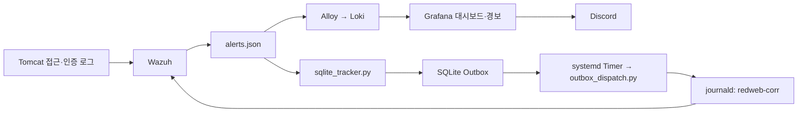

# REDWEB 관제 코드 및 설정

2026-11-02에 VPS에서 수집한 보안 관제·모니터링 코드와 설정의 공개용 정리본입니다. 웹 소스와 별도로 운영되는 구성입니다.

## 처리 흐름

상관분석은 동일 IP의 AUTH·SQLi·XSS 이벤트를 최근 10분 범위에서 연결합니다. 두 유형은 TWO, 세 유형은 THREE이며 조합별 재알림 대기와 지연 이벤트 제한을 적용합니다. 반복 SQLi 자동 대응은 Wazuh에서 별도 실행 파일을 호출하는 경로입니다.

## 폴더 구성

| 경로 | 내용 |
|---|---|
| `redweb-xdr/` | 상관분석, SQLite Outbox, 전송·격리, 방어 모드 관리 Python 코드 |
| `helpers/` | Wazuh 기동 전 오래된 PID 파일 검사 |
| `systemd/` | 관제 서비스·전송 타이머·Wazuh 시작 전 검사 설정 |
| `wazuh/` | 사용자 정의 규칙·디코더, 수집·자동 대응 설정 예제 |
| `monitoring/` | Compose, Prometheus, Alloy, Loki, Exporter 설정 |

운영 추적기는 `redweb-xdr-sqlite-preview.service`, 전송기는 `redweb-xdr-outbox-dispatch.timer`입니다. 예전 파일 기반 `redweb-xdr-preview.service`도 기록으로 보존했습니다. 두 추적기를 함께 활성화하는 설치 절차는 제공하지 않습니다.

## 비밀 값 및 로컬 설정

- 실제 `.env`, 관리자 보호 IP 목록, DB·Grafana 비밀번호, 운영 SQLite DB·로그·키는 포함하지 않았습니다.
- `.example` 파일의 `REPLACE_LOCALLY`와 보호 IP 예제는 로컬에서 설정해야 합니다.
- Compose에 필요한 `TOMCAT_GID`는 `monitoring/.env.example`에 변수 이름만 기록했습니다.
- Oracle Exporter 예제의 비밀번호 자리는 수집 과정에서 마스킹됐습니다. 로컬 설정 시 직접 값을 커밋하지 말고 컨테이너의 `DB_PASSWORD` 환경변수 참조 방식 등 실제 운영 구성과 맞춥니다.
- `MANIFEST.json`은 ZIP 생성 당시 파일·마스킹 기록입니다. 이후 저장소 검토 결과는 `REVIEW.md`에 별도로 기록했습니다.

## 복원 범위

이 자료는 소스·설정 기록입니다. 방화벽 초기화 실행 파일과 사용자 정의 자동 대응 스크립트 등 [추가 수집 항목](MISSING_COMPONENTS.md)이 있어 완전한 서버 복구 패키지로 볼 수 없습니다. Grafana DB 안에 저장된 대시보드·경보·연락처도 별도 내보내기가 필요합니다.

이번 저장 작업에서 VPS 서비스·방화벽·DB는 변경하지 않았습니다. 애플리케이션 실행·컨테이너 재기동·보안 공격 시험도 수행하지 않았습니다.
